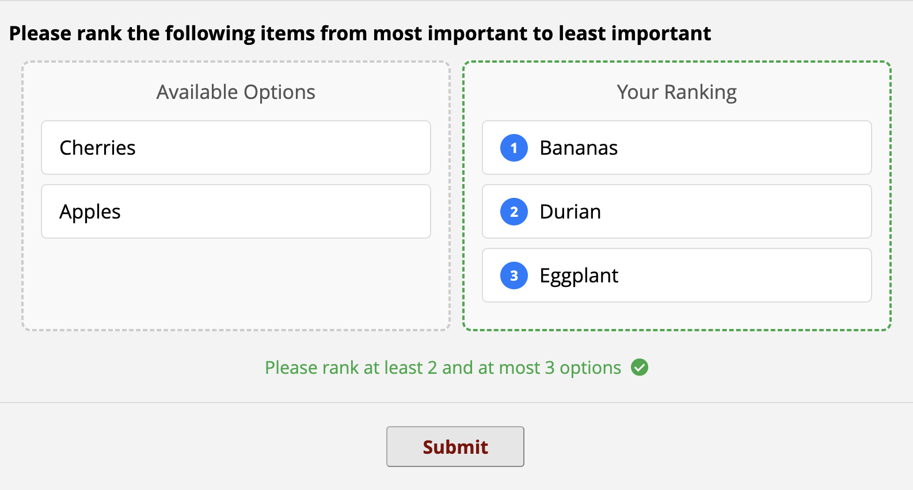

# Rank Field

This module provides a means to configure a drag-and-drop interface for survey pages, in which the respondent may drag options into an order. The order is then stored in a text field for each option, with an integer indicating its position in the order.



This behaviour is controlled by an action tag `@RANK`, which is applied to a descriptive text field, and which takes the variable names of the options to be ranked, each of which ought to be a text entry field (with either number or integer validation, or no validation at all).

## Basic Usage

The basic syntax for this is to provide the variable names for the options to be ranked as a comma-separated list as an argument to the action tag:

```
@RANK=field1,field2,field3,field4,field5
```

All fields are expected to be ranked by the respondent, and a message will be displayed informing them that they should rank all N items.

## Advanced Usage

Optionally, the `@RANK` action tag may take a JSON object as an argument, with the following keys:

| Key | Example Value | Description |
| --- | ----- | ----------- |
| `fields` | `field1,field2,field3,field4,field5` | (Required) Comma-separated list of fields to be ranked |
| `min` | `2` | (Optional) Minimum number of items that must be ranked |
| `max` | `5` | (Optional) Maximum number of items that may be ranked |
| `message` | `false` | (Optional; default `true`) Display a message to respondents below the ranking table describing how many (min and/or max) options are to be ranked |
| `randomise` (or `randomize`) | `true` | (Optional; default `false`) Randomise the order of the options to be ranked, to reduce bias |
| `prefill` | `false` | (Optional; default `false`) Put all options into ranking pane and hide source pane. Leave option 'max' empty. |

All string keys and values must be wrapped in double quotes; integer and boolean values may be left unquoted. A full example would be:

```
@RANK={
    "fields":"field1,field2,field3,field4,field5",
    "min":2,
    "max":5,
    "message":false,
    "randomize":true,
    "prefill":false
    }
```

## Branching Logic

The module supports branching logic in the sense that options are included in the rank area if they are visible due to branching logic. The entire ranking descriptive text field may also be controlled by branching logic. If it is hidden, the ranking option fields are still not visible to the user; they are converted into draggable tiles but are not displayed until such time as the descriptive text field is visible.

## Positioning

By default, the ranking table will appear at the bottom of the descriptive text field that is annotated with `@RANK`, however the designer can control the exact position by adding a `div` element with the id `rank-ui-<fieldname>` anywhere inside the descriptive text field label.

## Option order 

The order of elements in the left 'Available Options' pane is controlled by the order in which the variables are referenced in the `@RANK` action tag, unless the `randomise` option is set to `true`, in which case the order is shuffled on each page load.

## Min/Max enforcement

Min and Max values for the number of options to be ranked, **are not enforced**; the module will not prevent submission if fewer than `min` or more than `max` options have been ranked. The `message` will indicate to the user, based on the value of `min` and `max`, and how many options are visible due to branching logic, exactly how many options they are being asked to rank. The ranking area will be bordered in red if the number of ranked options does not comply with the `min` and `max` values, and wil turn green when the number of ranked options is correct. However, this is visual only and will nor prevent any submission.

To better control the enforcement of min and max ranked options, the [HIDESUBMIT](https://github.com/jangari/REDCap_HIDESUBMIT) External Module provides the ability to hide the submit button on a survey based on logic. For the advanced logic example above, the designer might construct a descriptive text field with the message 'You must rank at least 2 and at most 5 options', annotate this with `@HIDESUBMIT`, and use branching logic as follows:

```
sum(if([field1]<>'',1,0),if([field2]<>'',1,0),if([field3]<>'',1,0),if([field4]<>'',1,0),if([field5]<>'',1,0)) >= 2 AND sum(if([field1]<>'',1,0),if([field2]<>'',1,0),if([field3]<>'',1,0),if([field4]<>'',1,0),if([field5]<>'',1,0)) <= 5
```

That is, add 1 per field with any value, and check that the result is between 2 and 5. If the result is not between 2 and 5, then the submit button will be hidden; otherwise, it will be hidden, preventing the user from continuing.

It may be preferable in this case to suppress the default message using the `"message":false` option in the action tag.

## Internationalisation

This module utilises the EM Framework's Internationalisation (I18n) methods, thus allowing sites to translate all strings used by this module, including its name and description, the description of the Action Tag for the documentation in the online designer, and the message strings displayed to survey respondents.

To translate this module to another language, duplicate the `lang/English.ini` file and rename it to the language code of the language you want to translate to, e.g. `lang/Spanish.ini`. Then translate all strings in that file.

## Acknowledgements

This module is inspired by the Enhanced Drag and Drop Matrix Ranking option in Andy Martin's Survey UI Tweaks external module, which converts REDCap's built-in ranking Matrix field into a drag-and-drop interface, but implements this feature in a different way.

## AI Involvement Declaration

The core concept, features and overall direction of this module was developed by Aidan Wilson. Google's Gemini 2.5-Pro Large Language Model provided invaluable assistance in the development process; particularly with respect to debugging, fixing issues, and suggesting implementation strategies. All AI-generated or -influenced code has been thoroughly reviewed, tested and validated by Aidan Wilson.

